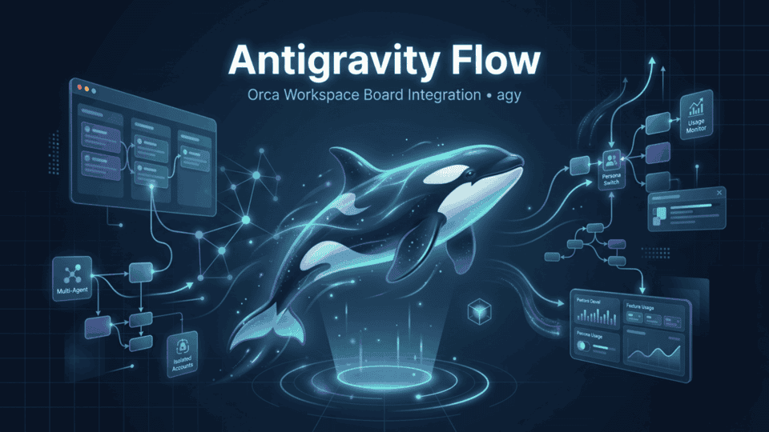

# Antigravity Flow



An Orca plugin to orchestrate agile startup workflows, multi-agent sprint pipelines, Orca Bot teams, work items, customizable personas, isolated Antigravity (`agy`) account switching, dynamic execution flags (such as `--dangerously-skip-permissions`), rich markdown startup prompts, host global skills sharing, and direct integration with Orca's **Workspace Board**.

---

## Quick Start (For New Orca Users)

1. Open **Antigravity Flow** from Orca's right sidebar — you will land on the **Start Here** tab.
2. Follow the live **3-Step Readiness Checklist**:
   - **1. Choose an Orca Workspace**: Open any project or Git worktree from Orca's left sidebar.
   - **2. Connect an Antigravity Account**: Click **Sign In Now** to authenticate at least one persona account.
   - **3. Pick Team Mode**: Keep **Auto Agent Team (Recommended — 100% automatic, zero setup)** or switch to **Orca Bots Team** if you already have bots in Orca.
3. Click any **1-Click Starter Mission** (**Launch Sprint Team**, **Launch Hotfix**, or **Launch Spike**) — your AI personas launch and coordinate with each other automatically.

---

## Key Features

1. **Beginner-Friendly "Start Here" Onboarding**:
   - Live 3-step readiness checklist (Workspace detection, Account sign-in status, and Team Mode picker).
   - **1-Click Starter Missions** for Sprint delivery, Rapid Bugfix, and Architecture Spike.
   - Built-in **New to Orca? Quick Guide** glossary explaining Workspaces, Agile Board, Startup Workflows, and Accounts.

2. **Agile Board with Synchronized Orca Workspace Board Lanes**:
   - **Lanes Synced to Orca**: Native 1:1 synchronization with Orca's default Kanban lanes:
     - `Todo` (`todo`): Backlog items ready to be planned or scheduled.
     - `In Progress` (`in-progress`): Actively assigned or currently running with an agent.
     - `In Review` (`in-review`): Code QA, testing, and PR verification.
     - `Done` (`completed`): Accepted, passing tests, and committed.
   - **1-Click Lane Transition**: Move cards between lanes instantly with responsive lane buttons.
   - **Lane Filtering**: Switch between `All`, `Todo`, `In Progress`, `In Review`, and `Done` filters.
   - **Direct Orca Workspace Board Integration**: 1-click **"Workspace Board"** button triggers Orca's built-in Kanban board (`workspace.openBoard`).
   - **"Run with Agent"**: Spawns `agy` in an isolated workspace terminal loaded with the task's full sprint, epic, and persona context, automatically updating status to `in-progress`.
   - **Real-Time Agent-to-Board Status Sync**:
     - Automatically listens to Orca's `agent.status.changed` events and inspects terminal output (`terminal.read`) for linked work items:
       - `working` -> **In Progress** (`in-progress`)
       - `waiting` / `blocked` or review requests in terminal (e.g. *"ready for review"*, *"please review"*, *"PR ready"*, *"minta review"*) -> **In Review** (`in-review`)
       - `done` (clean completion) -> **Done** (`completed`)
     - Supports explicit agent self-reporting via `node team-chat.mjs board --item <itemId> --status todo|in-progress|in-review|completed`.
     - Includes an on-demand **"Sync Agents"** button on the Agile Board header to pull live states from all active workspace agents (`agents.list`).

3. **Roadmap & Sprints Lifecycle**:
   - **Strategic Epics (Roadmap)**:
     - High-level product initiatives with milestone goals and status tracking (`planned`, `in-progress`, `completed`).
     - Real-time progress bar velocity calculations (`N / M story points • X% completed`) aggregated from all associated work items.
     - Add, edit, and delete Epics.
   - **Sprints Management**:
     - View sprint timeline, capacity in story points, and sprint goals.
     - **+ New Sprint**: Create upcoming iterations with custom start/end dates and target points.
     - **Complete Sprint with Task Rollover**: Archive completed sprints and automatically roll over unfinished tasks to an active or planning target sprint.
     - **Delete Sprint**: Delete sprints with inline confirmation and choose to move existing tasks to another sprint or remove them with the sprint.

4. **Default Startup Workflows with Built-In Agent & Bot Communication**:
   - **Goal-Driven Launches**: Target a full **Sprint**, **Epic**, **Single Work Item**, or **General Mission** (+ optional *Definition of Done*) before launching.
   - **Two Execution Modes**:
     - **Auto Agent Team (100% Automatic — Recommended)**: Spawns isolated `agy` persona terminals and creates a shared coordination room (`GOAL.md`, `ROSTER.md`, `THREAD.md`, live `PEERS.json` with terminal IDs, per-step `inbox/<step>.md`, and a zero-dependency `team-chat.mjs` CLI). Agents automatically post updates, ask questions, and hand off work to each other via `team-chat.mjs` and `orca orchestration send`.
     - **Orca Bots Team (Semi-Auto with Existing Orca Bots)**: Automatically discovers local Orca Bots from `~/.orca/bots/*/bot.json` and `SOUL.md`, maps steps explicitly (or auto-assigns available bots round-robin by default), and dispatches personalized peer-to-peer handoffs (`orca orchestration send --to bot:<name>`). If dedicated persona bots don't exist yet, the lead bot kickoff includes ready-to-run `orca bot create --offer` commands so you can approve them with one click in Orca.
   - **Pre-Built Startup Pipelines**:
     - **Agile Sprint: Feature Epic Delivery**: 5-stage pipeline chaining:
       1. *Product Manager & Scrum Lead* (Epic scope, user stories, acceptance criteria -> Todo)
       2. *Software Architect & Planner* (API contracts, data models, tech specs -> Todo / In Progress)
       3. *Senior Fullstack Developer* (Clean code implementation, TDD, unit tests -> In Progress)
       4. *Code Reviewer & QA Engineer* (Regressions, edge cases, acceptance verification -> In Review)
       5. *Security Auditor* (Permission boundaries, dependency checks, release gate -> Done)
     - **Agile Hotfix: Rapid Bugfix & Patch**: QA bug triage -> Fullstack surgical patch -> Security clearance.
     - **Agile Spike: Architecture & Tech Evaluation**: Architect prototype spike -> Developer estimation & feasibility.

5. **Antigravity Token Quota & Remaining Limits**:
   - **Live Token Quota Breakdown**: Queries `agy -p /usage --output-format json` in each account's isolated environment:
     - **Gemini Models** (Gemini 4 Neon, Hydrogen, Orchestrator, 3.8 Flash):
       - **5-Hour Limit Remaining**: Smooths out rolling demand (`X% remaining`, with exact countdown reset time `resets in 3h 50m`).
       - **Weekly Limit Remaining**: Individual plan capacity (`X% remaining`, with reset countdown `resets in 6d 6h`).
     - **Claude and GPT Models** (Opus 5.5, Sonnet 5.5, GPT-OSS 120B):
       - **5-Hour & Weekly Limits**: Dedicated 3rd-party capacity and remaining percentage.
     - **Gemini 4 Argon**:
       - Dedicated Pro/Ultra model quota bucket.
   - **Zero Cost / Zero Token Consumption**: Uses agy's official built-in `/usage` probe which consumes zero model turns and zero quota tokens.
   - **Color-Coded Badges**: Green (`>50% remaining`), Amber (`20%-50%`), Red (`<20% remaining`) for immediate visibility.
   - **1-Click "Refresh Quotas"**: On-demand real-time query across all configured accounts.

6. **Account Feature Usage Monitoring**:
   - **Aggregate & Per-Account Analytics**: Real-time velocity tracking for each account:
     - Total Direct Summons
     - Pipeline Workflow Steps Executed
     - Agile Tasks Completed & Total Story Points Delivered
     - Active / In-Progress Tasks
     - Disk & Cache Footprint (`~/.gemini-accounts/<id>/`) without counting symlinked host skills
     - Brain Conversations & Sessions Log Count
     - Last Active timestamp relative display (`Just now`, `5m ago`, `2h ago`)
   - **Chronological Activity Timeline Stream**: Live audit log of recent actions (`SUMMON`, `WORKFLOW`, `TASK`) with workspace and prompt context.
   - **Quick Badges in Accounts Tab**: High-level token quota and usage indicators directly on each account card with 1-click jump to detailed analytics.
   - **Maintenance**: 1-click "Refresh Stats" and "Clear History".

7. **Account & Credential Isolation**:
   - Isolates `HOME` and `GEMINI_HOME` on a per-account basis (under `~/.gemini-accounts/<account-id>/`).
   - Ensures distinct OAuth tokens, conversations, and settings without collisions.
   - **Automatic OAuth Email Sync**: Atomically reconciles each configured account's email with its authenticated `antigravity-oauth-token` (`id_token_email`) on load and quota sync, clearing stale emails on unsigned accounts and displaying the verified email badge directly on each **Configured Accounts** card.
   - Headless token storage fallback flags (`DBUS_SESSION_BUS_ADDRESS=""`, `SSH_CONNECTION="127.0.0.1"`).

8. **Access Host Global Skills (`~/.gemini/skills`)**:
   - Option to share host-wide global skills (`~/.gemini/skills/`, `~/.gemini/config/skills/`, `~/.gemini/antigravity-cli/skills/`) into each isolated account's environment via non-destructive symlinks.
   - Enabled by default per account with a toggle in the configuration form.

9. **Dynamic CLI Options & Flags**:
   - Dynamic toggle for `--dangerously-skip-permissions` to bypass interactive tool approval prompts.
   - Freeform input for arbitrary flags (e.g. `--model gemini-2.5-pro`, `--verbose`, `--sandbox`).
   - Configure flags at the account level or override them on the fly when summoning.

10. **Custom Agent Personas**:
    - Pre-configured startup roles:
      - *Product Manager & Scrum Lead*
      - *Software Architect & Planner*
      - *Senior Fullstack Developer*
      - *Code Reviewer & QA Engineer*
      - *Security Auditor*
      - *Custom Persona*
    - The worker automatically syncs persona instructions into `$GEMINI_HOME/rules/AGENTS.md` and `$accountDir/PERSONA.md`.

---

## Architecture & File Structure

```text
antigravity-flow/
├── orca-plugin.json      # Manifest v2 with trusted-worker, panels, settings, commands
├── src/
│   ├── protocol.ts       # Type-safe IPC contract between UI panel and background worker
│   └── panel.tsx         # Declarative TSX components panel (Agile Board, Workflows, Accounts)
├── worker/
│   └── main.mjs          # Trusted Node.js worker handling storage, sprint/epic state, and Workspace Board calls
├── tsconfig.json         # Standalone TypeScript definitions
└── README.md             # Documentation
```

---

## Development

1. **Load Development Plugin**:
   ```bash
   orca plugin dev load ./plugins/antigravity-flow
   ```
2. **Reloading Code Changes vs Refreshing Data**:
   - **Reloading Code Changes**: When editing plugin source files (`panel.tsx`, `main.mjs`), reload the Orca window with `Ctrl+R` / `Ctrl+Shift+R` (or Command Palette $\to$ **Reload Window**), or run `orca plugin dev reload`.
   - **Refreshing Data**: The **Refresh** button inside the panel header re-syncs the accounts, workspaces, and workflows from storage and clears previous status/error banners.
3. **Validate the Manifest** (same check the directory runs):
   ```bash
   pnpm validate:plugin path/to/orca-antigravity-flow
   ```

## Usage

1. Open the **Antigravity Flow** icon in the Right Sidebar Activity Bar.
2. Configure the two plugin settings (`accountsBaseDir`, `agyCommand`) under **Settings → Plugins** if your defaults differ from `~/.gemini-accounts` and `agy`.
3. Use the panel tabs:
   - **Start Here**: guided 3-step readiness checklist, 1-click starter missions, and a quick Orca glossary for newcomers.
   - **Agile Board**: manage work items and sprints; run agents in isolated workspaces.
   - **Roadmap**: plan Epics and track story-point velocity.
   - **Startup Workflows**: pick **Auto Agent Team** (100% auto) or **Orca Bots Team** (semi-auto with local bots), select a Sprint/Epic/Work Item goal, and launch collaborating persona teams.
   - **Accounts**: add isolated Antigravity accounts, toggle host skills sharing, and inspect per-account quota/usage badges.
   - **Usage & Quotas**: view live Gemini & 3rd-party token limits and chronological activity logs.

## Publishing

The Orca community directory lists plugins that:

1. Live in a public GitHub repo with `orca-plugin.json` (manifest v2) at the root, plus a `publisher` field and a `license` / `LICENSE` file.
2. Carry the `orca-plugin` topic.
3. Have a `vX.Y.Z` git tag.

There is no form and no review queue — the directory lists the newest tag, usually within an hour, after validation:

```bash
gh repo edit mqnoy/orca-antigravity-flow --add-topic orca-plugin
git add orca-plugin.json LICENSE
git commit -m "chore: publish-ready manifest"
git tag v1.0.0 && git push origin v1.0.0
```

Status page: `https://orca.dev/plugins/mqnoy/orca-antigravity-flow`.
